# Nihoban — Japanese learning app

Nihoban is an offline-first Japanese learning app for Android and Linux. The app is
a small `src/index.html` shell over split assets (styles, fonts, data, and code in
separate files — see *Project layout* below) — SRS flashcards, kana, kanji with
stroke order, grammar, custom decks, textbook audio with synced transcripts, and
AI-generated JLPT practice — wrapped by Capacitor (Android) and Electron (Linux).

**English + বাংলা UI · dark & light themes · no account, no network required**

| Home | Study session |
|---|---|
| 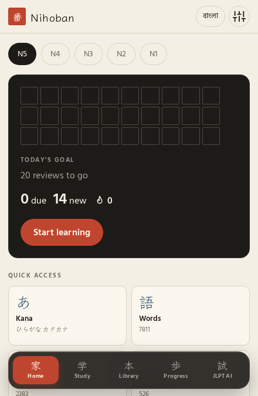 | 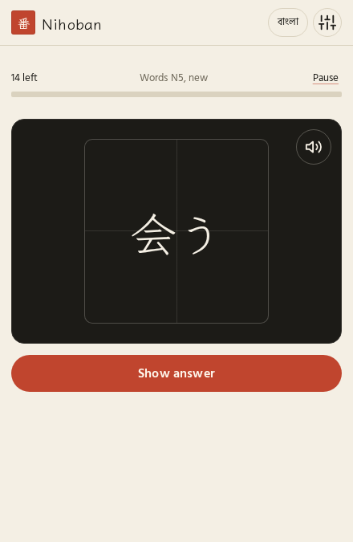 |

## Features

### Spaced-repetition study
- Mixed daily queue of **words, kanji and grammar** per JLPT level (N5–N1) with a daily goal ring.
- SM-2-style scheduling with Again / Hard / Good / Easy grading and 1-day–3-day+ intervals.
- Reverse review cards (meaning → Japanese), example sentences, and native text-to-speech
  on every word (system Japanese TTS, see below).
- Answer view with furigana, romaji, reading + audio, and the example sentence.

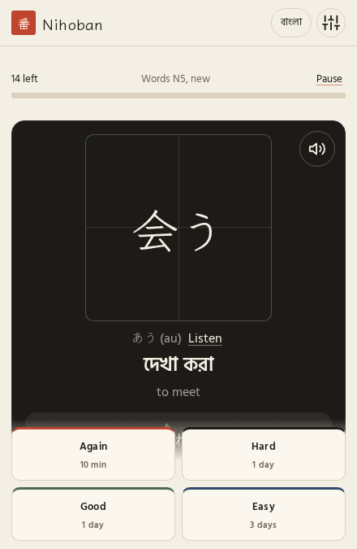

### Library
- **Kana** — hiragana & katakana chart, choice quiz, and typing quiz, with a romaji toggle.
- **Vocabulary** — 7,811 JLPT words with level filters, furigana and romaji toggles, search.
- **Kanji** — 2,383 kanji (JLPT-tagged) with animated **stroke order** (KanjiVG data),
  learning-state filters (New / Learning / Mastered / Saved), and search by Japanese,
  romaji, English or Bangla.
- **Grammar** — 526 grammar points.
- **Custom decks** — build your own deck out of any words and study it like the main queue.
- **Mistake notebook** — every wrong answer is kept for focused re-study.

| Kana | Kanji | Library |
|---|---|---|
| 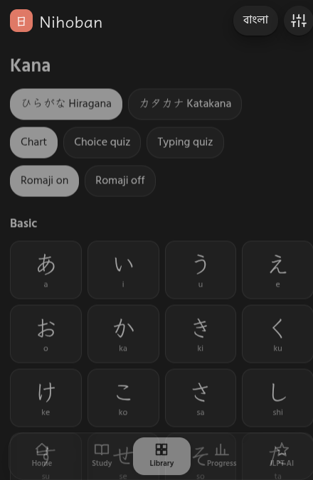 | 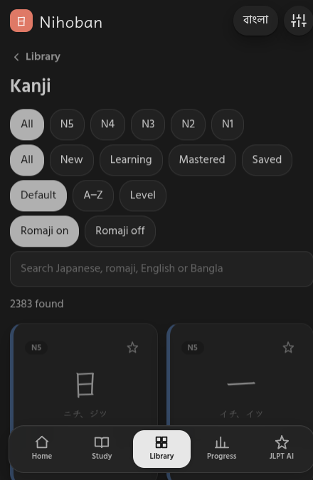 | 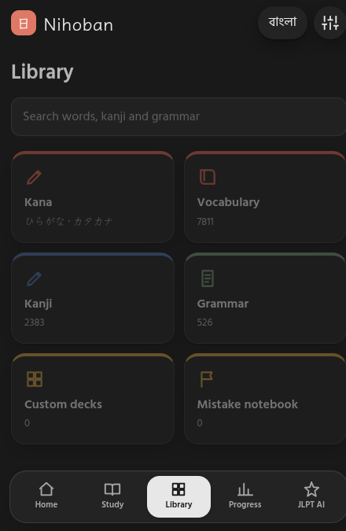 |

### Minna no Nihongo vocabulary
- All **2,692 words from the 50-lesson Minna no Nihongo series**, organized lesson by lesson.
- Per lesson: **Words → Flashcards → Quiz** flow with started/mastered tracking.
- Search across all 2,692 words; side-by-side word rows (Japanese left, romaji + meaning right).

| Lesson grid | Lesson 1 words |
|---|---|
| 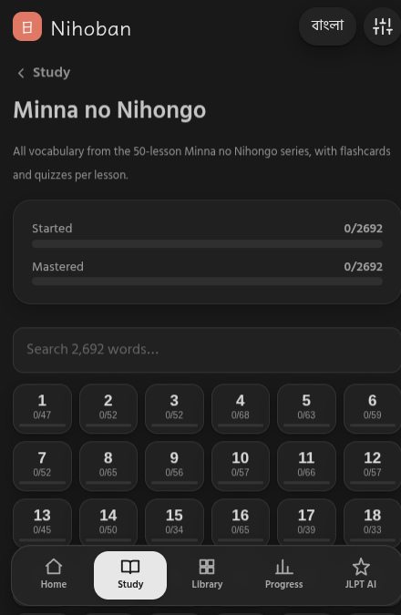 | 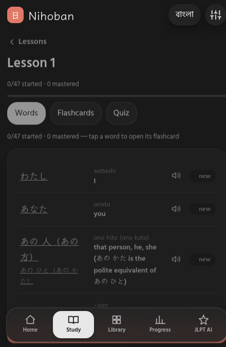 |

### Minna Dialogues — textbook audio with synced transcripts
- **87 audio tracks (lessons 1–25)**: the dialogue plus every exercise from the textbook,
  shipped inside the app and fully offline.
- **Synced transcript** that follows playback — the line being spoken is highlighted,
  and tapping any line seeks there.
- Furigana and reading toggles, playback speed **0.6×–1.5×** for shadowing.
- **Renamable speaker pills** (tap A/B to name the actual characters), per-track memory.
- Tracks are auto-marked as *listened* when they finish; per-lesson progress pills are
  color-coded by lesson.

| Lesson list | Player |
|---|---|
| 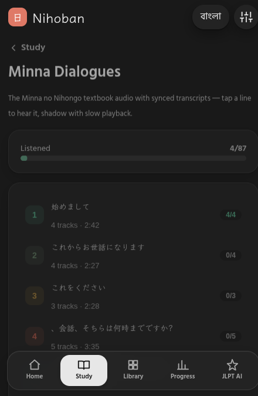 | 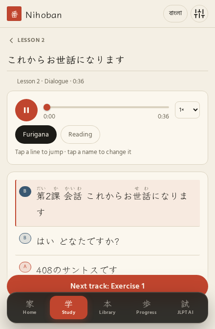 |

### Japanese Podcast — listening practice
- Listening-practice episodes with the same synced-transcript player as Minna Dialogues,
  organized by level (**N5** now, more coming). Each episode is credited to its source
  channel: [JSI55](https://www.youtube.com/@JSI55),
  [Aki-SenseiJPN](https://www.youtube.com/@Aki-SenseiJPN),
  [JapaneseTalkHimawari](https://www.youtube.com/@JapaneseTalkHimawari).
- Tap any line to seek, active-line follow while playing, furigana / reading toggles,
  playback speed **0.6×–1.5×**, renamable speaker pills.
- Episodes are compressed to mono Opus (speech-transparent) so they stay small
  while offline; auto-marked as *listened* when finished.

| Episode list | Player |
|---|---|
| 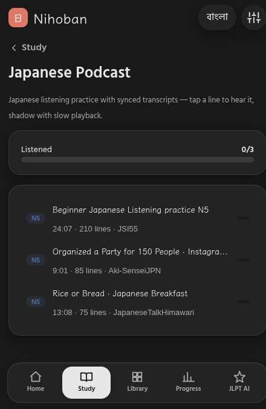 | 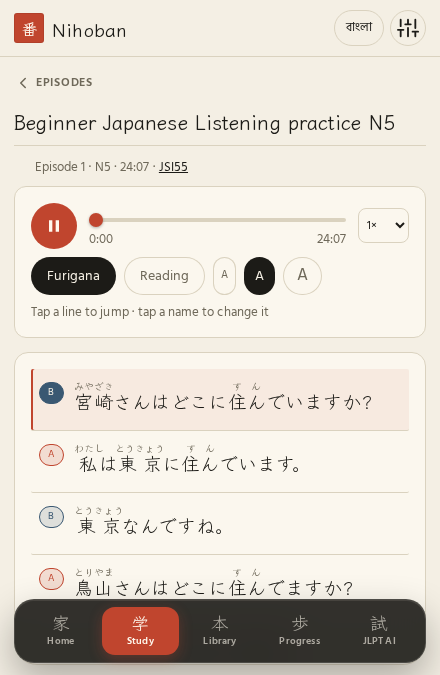 |

### Frequency Lab
- Measures how much **real-world Japanese** your vocabulary covers, against a
  15,000-word frequency corpus.
- Tabs: coverage of your mastered words, per-deck coverage, kanji coverage, and a
  **placement test** that estimates your level from what you know.

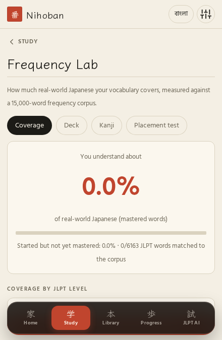

### JLPT AI Mock
- Practice questions generated by AI (bring your own API key in Settings) or built-in
  fallback questions, saved on-device.
- Choose level (N5–N1), question type (mix / vocab / kanji / grammar / reading),
  question count, and whether answers show after each question or at the end.

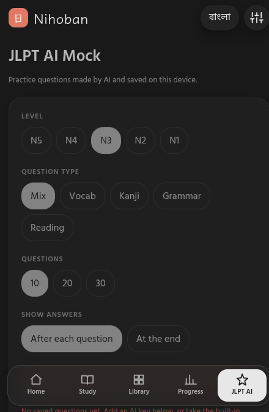

### Progress & settings
- XP and levels, **day streak**, weekly report, review/mastered counters.
- Dark & light themes plus color themes (Study Atelier, Japanese Zen, Sakura Dream,
  Midnight Japan); app language English or বাংলা.
- Daily goal, JLPT level, furigana defaults; backup & restore via a copyable code.

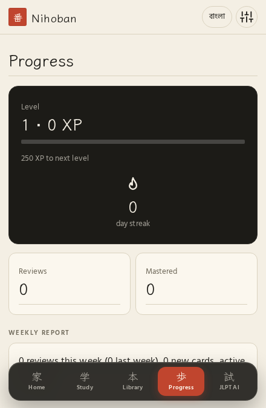

## Packaging

`src/index.html` is the app. Everything else packages it:

| Target  | Tool                        | Output                              |
|---------|-----------------------------|-------------------------------------|
| Android | Capacitor 8                 | `Nihoban-<version>.apk`             |
| Linux   | Electron + electron-builder | `Nihoban-<version>-x86_64.AppImage` |

## Releasing
Push to `main`/`master` → GitHub Actions builds both and publishes release `v1.0.<run number>`.
To pick the version: `git tag v1.2.0 && git push --tags`.
To update the app, replace `src/index.html` and push.

## Signing (so updates install over old versions)
`android-signing/nihoban.jks` + `signing.env` sign every APK, so every release has the same signature.
**Keep the GitHub repo private**, or anyone could sign APKs as you. Back the keystore up – if it is lost,
users must uninstall before updating.
To use GitHub secrets instead (safer): add `ANDROID_KEYSTORE_BASE64` (`base64 -w0 your.jks`),
`ANDROID_KEYSTORE_PASSWORD`, `ANDROID_KEY_ALIAS`, `ANDROID_KEY_PASSWORD`, then delete `android-signing/`
from the repo. Secrets take priority when present. (Switching keys later also forces a reinstall.)

## Native Japanese TTS
The native TTS bridge is injected at build time and routes the page's `speechSynthesis` calls to:
- **Android**: the system TextToSpeech engine through our own plugin
  (`android-overlay/.../NihobanTTSPlugin.java`, no third-party dependency). If no Japanese voice is
  installed, the app opens the system voice-data installer once.
- **Linux**: `spd-say`, then `espeak-ng`/`espeak`: `sudo apt install speech-dispatcher espeak-ng`
- Falls back to the browser Web Speech API if the native engine fails.

## Fonts
The fonts are committed as woff2 files in `src/fonts/` (Klee One for Japanese,
Hind Siliguri + Noto Sans Bengali for UI/Bangla) and loaded through
`src/css/fonts.css` — no network needed at build or run time.

## Project layout
`src/index.html` is a thin shell (~2 KB) referencing the real assets:
- `src/css/fonts.css` + `src/css/style.css` — styles
- `src/fonts/*.woff2` — offline fonts
- `src/data/*.js` — gzipped+base64 datasets (`d` app data, `so` stroke order,
  `fq` frequency corpus, `mn` Minna vocab, `dg` dialogue transcripts, `pd` podcast
  transcripts), decoded at runtime by `dec()` in `js/core.js`
- `src/js/*.js` — app code (`core`, `ui`, `ai`, plus one `feature-*` per module)
- `src/audio/` — dialogue and podcast audio

`npm run prepare-www` copies everything into `www/` and injects the native-TTS
bridge into `www/index.html`.

## Local dev
```bash
npm install
npm start               # desktop app
npm run dist:linux      # AppImage into dist-electron/
```

## Credits
- Stroke data: [KanjiVG](https://kanjivg.tagaini.net), CC BY-SA 3.0.
- Minna no Nihongo audio & transcripts: educational use, from the
  [truncripbe](https://github.com/) transcript dataset.
- Japanese Podcast episodes: from the [JSI55](https://www.youtube.com/@JSI55),
  [Aki-SenseiJPN](https://www.youtube.com/@Aki-SenseiJPN) and
  [JapaneseTalkHimawari](https://www.youtube.com/@JapaneseTalkHimawari) YouTube channels.
- Built with [Capacitor](https://capacitorjs.com) and [Electron](https://electronjs.org).
